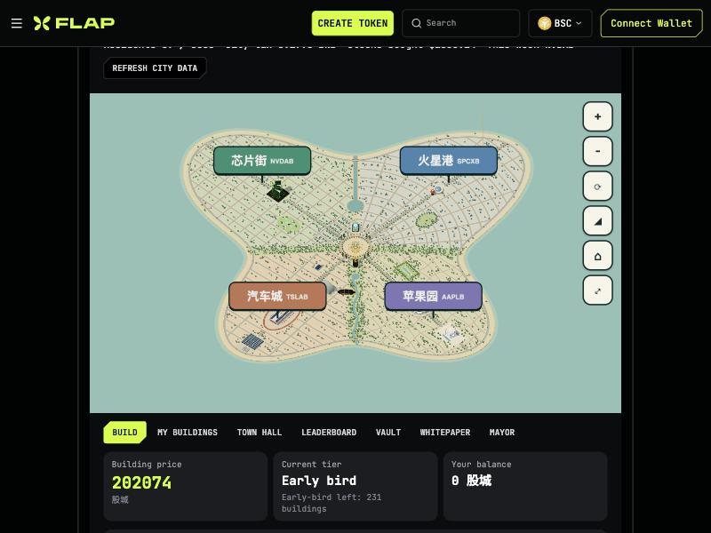

# Исследование: Flap и «Stockopolis» (股城) — идея «на потом» для проекта на Solana

Составлено 2026-10-20 по просьбе Романа. Роман хочет после запуска «государства» посмотреть в сторону похожего проекта на Solana. **Это не план и не решение, а собранный материал**: что это, как устроено, где лежит код, как рисуется «город», что можно взять. Всё прочитано только чтением (никаких транзакций, кошелёк не подключался).

> Как читать цифры: они на момент просмотра (20.10.2026) и быстро меняются. Что проверено мной по сети/коду — помечено «проверено»; что взято из описания проекта — «со слов проекта».

---

## 0. Коротко
- **Flap** (flap.sh) — платформа запуска токенов в сети BNB Chain с «налоговыми» токенами и программируемыми «хранилищами» (vault): налог с торгов попадает в контракт-хранилище, а оно делает с деньгами что запрограммировано.
- **Stockopolis (股城, «Город акций»)** — токен на этой платформе. Налог 1% с торгов → хранилище → покупает токенизированные акции США (NVIDIA, SpaceX, Tesla, Apple) → делит их поровну между «домами» (NFT). Дом покупается **сжиганием** токенов, всего 3000 домов. Вокруг этого игра: районы, гонка районов, недельное голосование какую акцию покупать, рейтинги, приглашения, «высота» дома.
- «**Экранчик с городом**» — это 3D-карта (three.js, WebGL2), отдельный пакет интерфейса («Vault UI»), который платформа показывает на странице токена. Данные берёт прямо из блокчейна. У платформы есть **открытый шаблон** для таких экранов (MIT).
- Код токена открыт и «чистый» (нет владельца, нет выпуска, чёрных списков, смены налога). Код **хранилища** в открытых реестрах не нашёл; оно **обновляемое** платформой.

---

## 1. Ссылки (всё в одном месте)

| Что | Ссылка |
|---|---|
| Страница, которую прислали Роману (**зеркало**, не основной домен; кошелёк там не подключать) | https://utter.cash/bnb/0xaacbc156435dbab7815a61bccba1c827e52a7777/taxinfo?lang=en |
| Официальный сайт платформы | https://flap.sh |
| Документация платформы | https://docs.flap.sh/flap (оглавление: https://docs.flap.sh/flap/llms.txt, страницы доступны как `.md`) |
| Аудиты (по документации) | https://docs.flap.sh/flap/audit-reports.md , CertiK: https://skynet.certik.com/projects/flap |
| GitHub платформы | https://github.com/flap-sh (3 публичных репозитория, ниже) |
| **Шаблон «экранчиков»** (MIT, Next.js) | https://github.com/flap-sh/flap-vault-component-template |
| Пример хранилища + правила проверки хранилищ | https://github.com/flap-sh/FlapVaultExample |
| Навыки для ИИ-агентов | https://github.com/flap-sh/flap-skills |
| Документация, где описаны хранилища | https://docs.flap.sh/flap/developers/vault-developers.md , https://docs.flap.sh/flap/developers/vault-developers/vault-and-vaultfactory-specification.md , https://docs.flap.sh/flap/developers/vault-developers/building-a-vault-ui.md |
| Исходный код токена (Tax Token V3) в открытом реестре Sourcify | https://repo.sourcify.dev/56/0x024f18294970B5c76c0691b87f138A0317156422 (API: https://sourcify.dev/server/v2/contract/56/0x024f18294970b5c76c0691b87f138a0317156422?fields=sources) |

---

## 2. Адреса контрактов (сеть BNB Chain, chainId 56)

| Что | Адрес | Что известно |
|---|---|---|
| **Токен 股城 (Stockopolis)** | [`0xaacbc156435dbab7815a61bccba1c827e52a7777`](https://bscscan.com/address/0xaacbc156435dbab7815a61bccba1c827e52a7777#code) | тонкий «клон» (45 байт, ERC-1167); адрес оканчивается на `7777` — так помечены налоговые токены Flap. Всего 1 000 000 000 монет |
| Логика токена — **Flap Tax Token V3** | [`0x024f18294970B5c76c0691b87f138A0317156422`](https://bscscan.com/address/0x024f18294970B5c76c0691b87f138A0317156422#code) | **исходник открыт** (Sourcify: `FlapTaxTokenV3`, 24 файла, главный — 468 строк) |
| **Хранилище «города»** (CityVault) | [`0xe4f66fdeb01209b0d1e630330c34491e45175557`](https://bscscan.com/address/0xe4f66fdeb01209b0d1e630330c34491e45175557) | прокси-«обёртка» (BeaconProxy, 512 байт). В него идёт весь налог |
| Логика хранилища (реальный код) | [`0x95c3445aaf076a1140e8709212fe539291683ca8`](https://bscscan.com/address/0x95c3445aaf076a1140e8709212fe539291683ca8#code) | ≈24,5 КБ байт-кода; **в открытом реестре Sourcify нет**; открыт ли исходник на BscScan — не проверил (BscScan закрыт проверкой на бота) |
| «Маяк» хранилища (Beacon) | [`0x1742c9660595b62e20b9f38a6444c656aac0c4fe`](https://bscscan.com/address/0x1742c9660595b62e20b9f38a6444c656aac0c4fe) | 810 байт; хранит адрес текущей логики |
| Владелец маяка («Guardian» платформы) | [`0x9e27098dcd8844bcc6287a557e0b4d09c86b8a4b`](https://bscscan.com/address/0x9e27098dcd8844bcc6287a557e0b4d09c86b8a4b#code) | контракт `TransparentUpgradeableProxy` (исходник открыт, 9 файлов); **может сменить логику хранилища мгновенно** |
| Фабрика хранилищ | [`0xb86bcce9a5bd8a9f2ce6df677acc7285f323b9e3`](https://bscscan.com/address/0xb86bcce9a5bd8a9f2ce6df677acc7285f323b9e3) | создала это хранилище; платформа оценила риск как «низкий» (уровень 1), «официальным» хранилищем Flap не названо |
| **CityNFT** («дома») | [`0x7974361798eD0d58d810510dA0FFA239F0d44268`](https://bscscan.com/address/0x7974361798eD0d58d810510dA0FFA239F0d44268#code) | 13 КБ, **не** прокси (по описанию, не обновляемый) |
| Акции в хранилище | NVDAB `0x02fca66c1d1afb4e2a7884261eb00f63598a7436`, SPCXB `0xbe9d156892e55e7154bcd3cb0fea677f9d3103e1`, TSLAB `0x5b1910eaad6450e50f816082aa078c41f10c292f`, AAPLB `0x431a3bee82e2ca41e49895cbece5bb0f76a89b7a` | имена на сети: NVIDIA Corp / SpaceX / Tesla, Inc. / Apple; по 18 знаков |
| Тестовый «город» (боевые параметры, в манифесте интерфейса) | фабрика `0xD6403B7669A2871052a1b0D1a6F5375101AED81C`, токен `0x143241C679C44D609207df975BdF691e7A507777`, CityNFT `0xe6F1FBA54A1C2E46e0a39244b200a07562852547` | видно из манифеста экрана (раздел 6) |

Платформенные контракты на BNB (из документации, https://docs.flap.sh/flap/developers/deployed-contract-addresses.md): Portal `0xe2cE6ab80874Fa9Fa2aAE65D277Dd6B8e65C9De0` (v5.23.1), VaultPortal `0x90497450f2a706f1951b5bdda52B4E5d16f34C06`, Tax Token V3 Impl `0x024f18294970B5c76c0691b87f138A0317156422`, Tax Token Helper `0x53841c73217735F37BC1775538b03b23feFD8346`, Trigger Service `0xcf4EE25035CF883895110f367F5BA8172416a7F9`, FlapTokenLocker `0x0000A8B6741441BB4Ba0DFE313a2bc7b2Cf10000`.

---

## 3. Как устроен Stockopolis (по описанию проекта на странице, вкладка Whitepaper)

**Поток денег.** Каждая покупка и продажа токена платит **налог 1%**. Он целиком уходит в хранилище (это обеспечивает фабрика хранилищ) в BNB:
- **70%** — покупка акций для «жителей»: делится поровну между всеми существующими домами, забрать можно в любой момент;
- **15%** — «резерв района»: тоже покупает акции, копится за неделю и после воскресного подсчёта достаётся домам района-победителя;
- **15%** — операционные расходы (в BNB на мультисиг 2 из 3; из этой доли платится комиссия платформенному «триггеру» 0,0002 BNB за запуск).

**Покупка акций.** Раз в час платформенный «триггер» проверяет хранилище; когда накопилось ≥0,5 BNB, оно отдаёт до 3 BNB платформенному сервису обмена (VaultEx, комиссия 0,5%). Одновременно открыт один заказ, не чаще раз в 10 минут. Когда акции приходят, хранилище сверяет количество с эталонной ценой (Chainlink для NVDAB/TSLAB/AAPLB; для SPCXB — среднее за 30 минут по пулу); если не хватает более 4% — сделка отклоняется, BNB возвращается, покупки пауза на 6 часов. Через 24 часа без покупок триггер засыпает; любой может запустить заново.

**Дома.** 3000 NFT; дом №0 — «мэра», без дивидендов. Цена в долларах, платится **сжиганием токенов** (токены уходят на адрес сжигания). Ступени цены: ранняя (первые 6 часов, 300 домов) 40 USD; до №800 — 52; до №1500 — 68; до №2300 — 88; до №3000 — 120. Расчёт по живой цене токена с защитой от кратковременных скачков, у каждой покупки задан максимум сжигания. Район (4) и стиль (3) выбираются при покупке и потом не меняются. Дом свободно переводится (вместе с неполученными дивидендами). Приглашения: можно указать номер дома пригласившего — тому дарят украшения (флаг/неон/салют), дивидендов это не добавляет.

**Дивиденды и «высота».** Купленные акции делятся поровну на число домов; «Забрать» присылает все четыре акции на кошелёк (без ожидания и срока). «Высота» дома — это USD-стоимость уже забранных акций (L1…L5 от $0 до $100, дальше +уровень за каждые $50); высота только для вида.

**Игра.** Раз в неделю (воскресенье 20:00 по Пекину) каждый дом один раз голосует, какую акцию покупать на следующей неделе (побеждает лидер). Район, в котором за неделю построено больше всего новых домов, забирает 15%-й резерв. После продажи всех 3000 домов гонка заканчивается и резерв делится между всеми.

**Права и безопасность (так заявлено).** «Нет лазейки для вывода, команда не может трогать деньги хранилища и менять результат голосования»; мультисиг 2 из 3 только получает 15% операционных; платформа (**Flap Guardian**) единственная может обновлять хранилище (мгновенно, без срока уведомления); замена контракта цен — только с уведомлением за 48 часов; NFT-контракт не обновляемый; «версия r9 прошла аудит Flap». Предупреждение проекта: дивиденды зависят от объёма торгов, цены акций колеблются.

### Живые цифры (20.10.2026, проверено по сети)
| Показатель | Первое чтение | Позже в тот же день |
|---|---|---|
| Жителей (домов) | 57 из 3000 | 69 → **70** |
| Налог собрано в хранилище | 7,2348 BNB | 7,6957 → **8,2899 BNB** (≈$6 000 при BNB ≈ $729) |
| Куплено акций | $679,24 | **$2 855,15** |
| Цена дома | 183 062 токена | **≈202 000 токенов** |
| Мест по ранней цене осталось | 243 | 231 |
| Сожжено токенов (всего) | — | ≈27,77 млн (2,8% выпуска) |

Налог 8,29 BNB при ставке 1% означает, что торгов накопилось около **829 BNB (≈$605 тыс.)**. Проект сейчас на старте и активен: примерно за час просмотра прибавилось 13 домов.

---

## 4. Что показывает код (прочитано мной)

### 4.1 Токен (Flap Tax Token V3, исходник открыт)
- Обычный ERC-20 (OpenZeppelin upgradeable) + permit; налог берёт **сам токен** при переводах из/в пул, накопленное «ликвидируется» (продаётся за BNB) и уходит в хранилище.
- Состояния токена: `0` кривая бондинга (без налога) → `1` миграция → **`2` налог на переводах с ЛЮБЫМ пулом («антифармер»)** → **`3` налог только с главным пулом** → `4` без налога. Сейчас токен в состоянии **2**; «антифармер» заканчивается **2026-11-19 09:02 UTC**, дальше налог только на главный пул (то есть через **другой** пул налог можно обойти — это та же проблема, что и у нас, находка №6 аудита).
- Налог (1% покупка / 1% продажа) действует до **2126-09-26** — практически навсегда.
- В коде **нет**: владельца (на сети `owner = 0x000…0`, права отозваны), выпуска новых монет после создания, чёрного списка, паузы, функции смены налога. Единственные привилегированные функции `startMigration` / `finalizeMigration` (миграция на DEX).
- Справочный контракт `TaxTokenHelper.getTaxTokenInfoV2(token)` отдаёт: ставки, суммы, адрес хранилища, фабрику, уровень риска. По нему получено: налог 100% «маркетинг» = хранилище, `riskLevel = 1`, `isVault = true`, `isOfficialVault = false`.

### 4.2 Хранилище
- Прокси типа **BeaconProxy** (слот маяка ERC-1967): логика у маяка `0x1742…c4fe`, текущая реализация `0x95c3…3ca8` (≈24,5 КБ). Владелец маяка — **Guardian платформы** `0x9e27…8a4b` (сам — `TransparentUpgradeableProxy`, то есть тоже обновляемый).
- Следствие: заявление «нет лазейки для вывода» верно для **текущего кода**, но платформа может заменить код мгновенно. Доверие здесь — к платформе (ровно как у нас доверие к единственному ключу обновления).

### 4.3 Восстановленный интерфейс (35 функций, вытащено из пакета интерфейса; сверено с сетью)
**CityVault** (`0xe4f6…5557`): `nft()`, `residents()`, `totalTaxQuote()`, `vaultQuoteToken()`, `totalPurchasedUsd()`, `currentAssetIndex()`, `activeWeek()`, `calendarWeek()`, `weekEnd(week)`, `weekVotes(week,asset)`, `weeklyNewBuildings(week,district)`, `weekAssetIndex(week)`, `weekWinnerMask(week)`, `weekPool(week,asset)`, `weekPoolUsd(week,asset)`, `votedWeek(id)`, `claimedUsd(id)`, `pendingUsd(id)`, `assets(index)`, `claim(id)`, `claimMany(ids[])`, `voteAll(asset)`, `vote(ids[],asset)`, `settle(maxWeeks)`.
**CityNFT** (`0x7974…4268`): `ownerOf(id)`, **`buildings(start,count)` → `owners[], districts[], styles[], times[], invites[], heights[]`** (одна выборка отдаёт данные для рисования сразу многих домов), `districtOf`, `styleOf`, `builtAt`, `invitationCount`, `publicStart`, `mintPrice`, `earlyBird`, `buildingsOf(owner,start,count)`, `mint(district,style,inviter,maxPrice)`.
Проверено на сети: `nft()` хранилища = CityNFT; `residents = 70`; `totalPurchasedUsd = 2855.15`; `assets[0..3]` = четыре токена-акции; `earlyBird = true`.

---

## 5. Акции: что это за токены (и аналог в Solana)
- **bStocks (NVDAB, TSLAB, … на BNB)** — токенизированные акции **Binance** (BEP-20). По данным агрегатора, эмитент — BTech Holdings Limited (аффилирована с Binance); описываются как сертификаты под правилами ADGM (Абу-Даби), для допущенных **не-американских** пользователей. На странице есть вызов `…/api/bstocks/eligibility` — проверка допуска пользователя. Это **юридически чувствительная** часть любого подобного проекта. Источники: [CoinGecko — NVIDIA bStocks](https://www.coingecko.com/en/coins/nvidia-bstocks), [HackerNoon про bStocks в Trust Wallet](https://hackernoon.com/lite/trust-wallet-adds-bstocks-to-put-tokenized-nvidia-and-tesla-inside-a-self-custody-wallet). SPCXB («SpaceX») и AAPLB («Apple») по поиску я не подтвердил; на сети они существуют под этими именами.
- **На Solana аналог — xStocks** (Backed Finance): запущены 30.06.2025, обеспечены акциями 1:1 у регулируемого хранителя, 60+ бумаг (Apple, Nvidia, Tesla и др.), торгуются через Jupiter, Raydium, Kamino, Phantom. Источники: [Backed — xStocks are going live](https://backed.fi/news-updates/xstocks-are-going-live-tokenized-stocks-for-the-defi-era), [Solana Foundation — case study xStocks](https://solana.com/news/case-study-xstocks). Сведения 2025 года — **перед любым использованием перепроверить актуальность и условия** (в том числе ограничения по странам).

---

## 6. «Экранчик с городом»: как он устроен
**Что видно:** 3D-остров в форме бабочки, четыре района (芯片街 «Chip Street» — NVDAB, 火星港 «Mars Harbor» — SPCXB, 汽车城 «Motor City» — TSLAB, 苹果园 «Apple Park» — AAPLB), дороги от центральной площади мэра, деревья, дома трёх стилей (发光芯片塔 «светящаяся чип-башня», 服务器楼 «серверное здание», AI 舱 «AI-капсула»). Управление: перетаскивание, вращение правой кнопкой, колесо — масштаб; кнопки «Zoom in/out», «Rotate 45°», «Street view / top view», «Back to Mayor Plaza», «Whole city»; клик по дому или достопримечательности открывает подсказку «мэра». Под картой вкладки: Build, My buildings, Town hall, Leaderboard, Vault, Whitepaper, Mayor. Снимок экрана: `docs/img/stockopolis-city.jpg`.

**Технически (проверено по загруженным файлам страницы):**
- Это **не часть сайта Flap**, а отдельный пакет «Vault UI» от авторов проекта (`artifactId` `vaultui_stockopolis_01M5839BK6GVZ3QEBWNG1MGFTQ`, имя «股城 Stockopolis»), который платформа подгружает на страницу токена. Файлы лежат в публичном хранилище Vercel Blob (`…public.blob.vercel-storage.com/vault-ui/vaultui_stockopolis_…/<версия>/`): `manifest.json`, `metadata.json`, `i18n.json` (46 КБ, китайский и английский), `artifact.css` (21 КБ), **`component.mjs` (2,3 МБ)** и **две картинки .webp**.
- Версия на 20.10.2026: `v20261020041636847_stockopolis_6214af6f47d8` (собрана в тот же день — пакет активно обновляют). Собрано `flap-artifact-workbench` (esbuild), SDK `@flapsdk/vault-runtime@0.1.37`; во внешних зависимостях платформы: react, react-dom, wagmi, viem, @tanstack/react-query, rainbowkit.
- В манифесте объявлена возможность **`three-r3f-v1`** — то есть **three.js через React Three Fiber** (WebGL2). На странице один `<canvas>` ≈1340×806 с WebGL2; есть и несколько 2D-канвасов (подписи/текстуры), шейдеры (`gl_FragColor`), цикл анимации (`requestAnimationFrame`).
- **Данные — прямо из блокчейна:** на странице ≈22 вызова публичного RPC BNB (`bsc-dataseed.bnbchain.org`) плюс цена BNB с `api.binance.com/api/v3/avgPrice`. Нет WebSocket и своих серверных запросов в самом пакете, поэтому «реальное время», по всей видимости, это периодический опрос (react-query из платформы) и кнопка «Refresh city data». Расстановка домов выводится из номера дома и района: «участки в районе заполняются от центра, ранние дома ближе к мэру»; высота дома берётся из `heights`.
- Манифест связывает экран с **фабрикой** `0xB86b…b9E3` (боевой город) и с тестовой фабрикой `0xD640…D81C` (тестовый город на боевых параметрах).

**Открытый шаблон для таких экранов** — `flap-sh/flap-vault-component-template` (MIT; Next.js; `yarn && yarn dev`; примеры `/example`, `/dex-listed-example`, `/community-buyback-example`, `/flapixel-example` (NFT-хранилище)). Правила: пакет — ровно **4 файла** (`Component.tsx`, `manifest.json`, `VaultABI.ts`, `i18n.json`), без вспомогательных файлов и локальных ресурсов (картинки/текстуры нужны процедурно или через платформу; в режиме «mini-app» разрешено рецензируемое аудио ≤5 МБ), чтение/запись/кошелёк — только через SDK платформы; обязателен показ текущего статуса риска; запрещена произвольная вёрстка «сайта в сайте». В прод пакет попадает через «Flap Artifact Workbench» (проверка → сборка → статическое хранилище → привязка к фабрике).

---

## 7. Правила платформы для хранилищ (из `FlapVaultExample`, полезно как образец)
- **Правило 001 (хранилище и фабрика).** Хранилище наследует `VaultBaseV2`. Если у проекта есть фабрика хранилищ, она может брать комиссию с налога; рекомендация платформы: при налоге ≤1% — **6% от поступления**, при большем — `6/налог_в_bps`. **Guardian** (нейтральная сторона — платформа) должен иметь доступ ко всем привилегированным функциям, и **никто, кроме него самого, не может этот доступ отозвать**.
- **Правило 003 (честность).** Любой привилегированный путь, позволяющий «своим» извлекать выгоду за счёт пользователей, недопустим; отдельно — риск «сэндвич-атак» (нельзя менять проскальзывание/тайминг/маршрут так, чтобы потом торговать поверх потока пользователей). «Dev» — любая роль с привилегиями, не только владелец.
- **Правило 009 (аварийное управление).** Необновляемые хранилища **обязаны** иметь аварийные функции вывода (`emergencyWithdrawNative/Token`) **только для Guardian**; обновляемые (BeaconProxy и т. п.) от этого освобождены — их аварийный путь это обновление Guardian-ом. Идея, которую стоит запомнить: **аварийные полномочия держит нейтральная сторона, а не команда проекта** (поэтому «команда не может трогать деньги»).

---

## 8. Аудиты (что удалось подтвердить)
По документации платформы: CertiK — Flap Launchpad Protocol V2 и V4, Tax Token V1 (страница [CertiK Skynet](https://skynet.certik.com/projects/flap)); BlockSec — Tax Token V1, Launchpad Protocol V5 (включая Tax Token V2 и PreLaunch V1). **Для Tax Token V3 и для хранилища Stockopolis отчёта я не нашёл** — только слова проекта «версия r9 прошла аудит Flap». Метки «Passed FAC» / «Low risk» на странице — внутренняя оценка платформы.

---

## 9. Идеи для Solana (черновик, не решение)
| В Stockopolis (BNB) | Как это могло бы выглядеть на Solana |
|---|---|
| Налог 1% на торги (токен берёт налог сам) | наша модель: комиссия пула Meteora → казна-программа (уже есть и проверена); либо Token-2022 TransferFee |
| Хранилище-контракт | программа Anchor; счёт хранилища — PDA без ключа (как наша казна) |
| Дом = NFT, цена в USD, оплата **сжиганием** токенов | NFT на Metaplex Core или Token-2022; сжигание монеты при покупке (цена по оракулу Pyth/Switchboard) |
| Дивиденд поровну на дом | счётчик «награда на долю» (накопительный индекс) — учёт без перебора всех домов |
| Покупка акций через VaultEx + проверка цены 4% | обмен через Jupiter из программы с проверкой цены по оракулу, откат при отклонении (то же нужно нашему будущему «долить ликвидность из казны») |
| Часовой «триггер» | открытая функция, которую может вызвать любой + наш бот |
| Недельное голосование, гонка районов | можно построить на нашем механизме голосований/снимков, либо отдельный простой счётчик |
| 3D-город на three.js | React Three Fiber; данные читать из аккаунтов программы (Helius/DAS для NFT, подписки на аккаунты для «реального времени») |
| Акции NVDAB… | xStocks (Backed) — проверить актуальность, ограничения по странам, возможность заморозки эмитентом |

**Вопросы и риски, которые надо решить заранее:** юридическая сторона выплат в токенах акций и допуск пользователей по странам (у bStocks уже есть проверка допуска); зависимость от эмитента токенов акций (может заморозить); чей ключ обновления и кто аварийный держатель (у Flap — нейтральный Guardian; у нас сейчас один ключ); внешний аудит (блокер, как и для «государства»); защита от обхода налога/комиссии через другие пулы (у Flap «антифармер» только 5 недель); анти-сибил (дом стоит $40–120, а дивиденд поровну на дом — выгодно дробиться; у Flap цена дома растёт по ступеням); расходы на хранение данных NFT на Solana; как на старте не получить «горку»: экономика держится на притоке новых жителей.

---

## 10. Как это проверено (повторить можно)
- Страница: читал через встроенный браузер (текст вкладок, `performance.getEntriesByType('resource')` для списка запросов, сеть страницы). Пакет экрана скачан из публичных ссылок Vercel Blob и разобран в браузере (моя среда агента эти адреса не открывает).
- Сеть BNB: вызовы `eth_call`, `eth_getCode`, `eth_getStorageAt` к публичному `https://bsc-dataseed.binance.org` (из встроенного браузера; из среды агента публичные BNB-узлы недоступны).
  - тип клона: `eth_getCode(токен)` = 45 байт `363d3d373d3d3d363d73<адрес логики>5af43d82803e903d91602b57fd5bf3`;
  - прокси-слоты ERC-1967: маяк `0xa3f0ad74…3d50`, реализация `0x360894a1…2bbc`; затем у маяка `implementation()` (`0x5c60da1b`) и `owner()` (`0x8da5cb5b`);
  - справка по токену: `TaxTokenHelper.getTaxTokenInfoV2(address)` (`0x6c06b371`) по адресу из таблицы платформы.
- Исходники: Sourcify API v2 (`GET /server/v2/contract/56/<адрес>?fields=sources`) — нашёл для логики токена и для Guardian; для хранилища, маяка, фабрики — нет.
- Документация: `https://docs.flap.sh/flap/llms.txt` + страницы `.md` (скачаны все 64).
- **Не удалось:** открыть BscScan (защита от ботов; обходить не стал), прочитать исходный код логики хранилища `0x95c3…3ca8` (не опубликован в открытых реестрах, на BscScan — не проверено). Если нужен код хранилища: открыть ссылку из таблицы в своём браузере, вкладка «Contract», и прислать текст/архив.

---

## 11. Осторожно
- `utter.cash` не подтверждён как официальный домен платформы; на странице есть кнопки подключения кошелька и «Approve». **Не подключать кошелёк и ничего не подтверждать.** Для настоящих действий — только официальный сайт платформы.
- Это не совет вкладываться. Оценка проекта (устойчивость экономики, юридические риски) здесь не даётся.
- Все цифры на 20.10.2026 и меняются; описание проекта (раздел 3) — его собственные слова, не независимая проверка.
